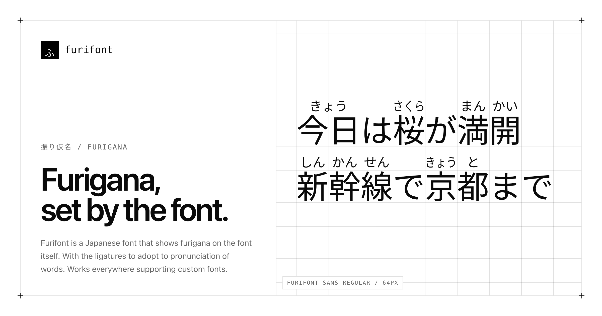

# Furifont


**Furigana, set by the font.** A Japanese font that shows furigana by itself. The text stays plain: no `<ruby>` markup, no JavaScript, no plugin. It works everywhere that supports custom fonts.

**[Try it on furifont.antfu.me](https://furifont.antfu.me)**

```html
<p style="font-family: 'Furifont Sans'; line-height: 1.7">今日は日本語の勉強をします。</p>
```

## How it works

Furifont is compiled from Source Han Sans JP or Source Han Serif JP. A build step reads a dictionary of thousands of words and draws the ruby into new glyphs. For each word, the font holds a ligature: 今日 becomes one glyph with きょう above it. Longer words win (日本語 before 日本), and a kanji with no clear reading stays bare. Details on the [website](https://furifont.antfu.me) and in [docs/design.md](docs/design.md).

## Choosing a reading

Put a variation selector, an invisible character, right after the first kanji of a word: VS226 gives reading 1, VS227 reading 2, and VS225 removes the ruby. The [reference page](https://furifont.antfu.me/#/reference) lists every reading.

## Download

Each [release](https://github.com/antfu/furifont/releases/latest) has Sans and Serif, in Hiragana and Romaji, Regular as OpenType and WOFF2, and a variable font of every weight from ExtraLight to Heavy (`Furifont Sans VF`), as TrueType and WOFF2, whose ruby follows the weight of the text. Set `line-height` to 1.6 or more so the ruby is not clipped.

## On websites

The [website](https://furifont.antfu.me) has a bookmarklet and a [userscript](https://furifont.antfu.me/furifont.user.js) that set any page in Furifont, with optional okurigana readings.

## Build your own

Choose another base font, word list, ruby letters or sizes. Needs Node 22.18 or later.

```sh
npx furifont dev     # Customize: live preview in your browser
npx furifont build --base "Source Han Serif JP Bold" --script hepburn --family "My Furigana"
```

Settings live in `furifont.config.json`; their defaults are in [`packages/core/src/defaults.ts`](packages/core/src/defaults.ts).

| Package | |
| --- | --- |
| [`furifont`](packages/cli) | The CLI and the server behind Customize |
| [`@furifont/core`](packages/core) | Plans glyphs and OpenType rules from a dictionary |
| [`@furifont/compiler`](packages/compiler) | Draws the planned glyphs into a base font |
| [`@furifont/dictionary`](packages/dictionary) | The compiled dictionary |
| [`@furifont/helper-web`](packages/helper-web) | Sets the Japanese text of any web page in Furifont: the bookmarklet's and the userscript's engine |
| [`packages/app`](packages/app) | The website and Customize (Nuxt) |

See [CONTRIBUTING.md](CONTRIBUTING.md) to work on it.

## Credits

Furifont is inspired by:

- [Mengshen-pinyin-font](https://github.com/MaruTama/Mengshen-pinyin-font), which puts pinyin on Chinese characters inside the font.
- [Fira Code](https://github.com/tonsky/firacode), which uses OpenType ligatures to change how text looks.

## License

- **Code:** [MIT](LICENSE.md).
- **Fonts:** [SIL OFL 1.1](OFL.txt), derived from Source Han Sans and Serif by Adobe.
- **Dictionary data and reading rules:** [CC BY-SA 4.0](packages/dictionary/LICENSE.md), from JMdict, JMnedict, KANJIDIC2 (EDRDG), JmdictFurigana and yomitan-jlpt-vocab.
