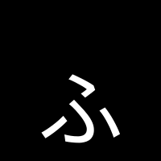

<p align="center"></p>

# Furifont

A Japanese font that shows furigana by itself. The text stays plain: no `<ruby>` markup, nothing extra to copy, search or read aloud. The font looks each word up in its own rules and draws the reading above the kanji. [Try it on furifont.antfu.me](https://furifont.antfu.me).

```html
<p style="font-family: 'Furifont Sans'; line-height: 1.7">今日は日本語の勉強をします。</p>
```

Furifont is built from [Source Han Sans JP](https://github.com/adobe-fonts/source-han-sans) and [Source Han Serif JP](https://github.com/adobe-fonts/source-han-serif), and a dictionary compiled from [JMdict](https://www.edrdg.org/jmdict/j_jmdict.html), [JMnedict](https://www.edrdg.org/enamdict/enamdict_doc.html), [JmdictFurigana](https://github.com/Doublevil/JmdictFurigana) and [KANJIDIC2](https://www.edrdg.org/wiki/index.php/KANJIDIC_Project), with JLPT levels from [yomitan-jlpt-vocab](https://github.com/stephenmk/yomitan-jlpt-vocab). The tools that build it work with other base fonts and other word lists.

## Fonts

Each [release](https://github.com/antfu/furigana-font/releases/latest) has eight fonts, as OpenType and WOFF2:

| Family | Base | Ruby | Weights |
| --- | --- | --- | --- |
| Furifont Sans | Source Han Sans JP | Hiragana | Regular, Bold |
| Furifont Sans Romaji | Source Han Sans JP | Modified Hepburn, with macrons | Regular, Bold |
| Furifont Serif | Source Han Serif JP | Hiragana | Regular, Bold |
| Furifont Serif Romaji | Source Han Serif JP | Modified Hepburn, with macrons | Regular, Bold |

Each font also comes with a `.ivs.json` file. It lists the readings that the variation selectors pick, as described below. The Regular WOFF2s and their `.ivs.json` are also in [`fonts/`](fonts), as the site serves them. Katakana for on'yomi is a build option.

### Using them

- **Line height.** The ruby sits above the line, inside the font's ascender. A `line-height` below about 1.6 clips it, and `line-height: normal` always fits.
- **Turning ruby off.** `font-feature-settings: "ss01"` shows the plain kanji, and so does `"rclt" 0`.
- **Line breaks.** A word broken across two lines is read as two words. In Chromium, `word-break: auto-phrase` keeps phrases together.

### On any page

The [demo site](https://furifont.antfu.me) has a bookmarklet that sets the page you are reading in Furifont, and turns it off on a second click. The [userscript](https://furifont.antfu.me/furifont.user.js), for Tampermonkey or Violentmonkey, turns it on by itself on Japanese pages, and its menu switches the family. Both use Furifont when it is installed on your computer, and otherwise load the Regular WOFF2 from the site. They give lines with kanji room for the ruby. Sites that block fonts from other sites, such as X and GitHub, need Furifont installed for the bookmarklet, but not for the userscript. When neither works, a toast says so and links to the downloads.

### Which words get ruby

Browsers shape Japanese text one script at a time. The font sees a run of kanji, but never the kana next to it. So Furifont works on runs of kanji:

- **Runs of two or more kanji** are matched against a few thousand common words, longest first. 日本語 matches before 日本, and 今日 reads きょう as one word.
- **Protected words.** Some longer dictionary words would be misread through a shorter match. 大人気 contains 大人, for example. These longer words get their own reading, or stay bare when they can be read more than one way.
- **Place names.** Station names, and places with only one reading, fill the runs that no common word claims: 新宿, 渋谷, 池袋.
- **A kanji alone in its run** gets ruby only when one reading clearly dominates the common words it stands alone in. 桜 and 駅 get ruby. 書 (書く, 書) and 行 (行く, 行う) stay bare, but [selectors](#choosing-another-reading) can give them ruby.
- **Anything not in the dictionary** stays bare, as do kana and Latin text.

### Choosing another reading

To pick another reading, write a variation selector right after the first kanji of a word:

| Selector | Effect |
| --- | --- |
| VS225 (`U+E01E0`) | No ruby on this kanji |
| VS226 (`U+E01E1`) | Reading 1 |
| VS227 (`U+E01E2`) | Reading 2, and so on to VS240 |

After the first kanji of a word with several readings, the selector picks the word's reading. For example, `市\u{E01E2}場` shows しじょう instead of いちば. After any other kanji, it picks that kanji's own reading.

Selectors are invisible, survive copy and paste, and need no markup. The [reference page](https://furifont.antfu.me/#/reference) lists every reading and copies a word together with its selector.

## Build your own

You need Node 22.18 or later. From the command line:

```sh
npx furifont build --base "Source Han Serif JP Bold" --script hepburn --family "My Furigana"
```

Or open the studio. It runs in your browser with a live preview, the size of the font it would build, the dictionary, your own words, and a build button. It keeps your changes in the browser until you save them:

```sh
npx furifont dev
```

Both commands read `furifont.config.json` from the current folder, and the studio writes it for you:

```json
{
  "base": "Source Han Sans JP Regular",
  "family": "Furifont Sans",
  "rubyScript": "hiragana",
  "nfMin": 1,
  "nfMax": 30,
  "selectTags": ["spec1"],
  "skipJlpt": "N5",
  "isolated": true,
  "isolatedMinShare": 0.8,
  "places": true,
  "words": {
    "add": ["推[お]し活[かつ]"],
    "pin": ["市[し]場[じょう]"],
    "remove": ["大人"]
  },
  "metrics": { "rubyScale": 0.4, "rubyGap": 0.05, "compressionFloor": 0.6, "maxRubyWidth": 1.6 }
}
```

These are the settings:

- `base` names a font to download once, Source Han Sans JP or Source Han Serif JP with a weight (`Source Han Serif JP Bold`), or is the path to another OpenType font.
- `nfMax` sets how many words get ruby. Words are ranked in newspaper frequency buckets of about 500 words each.
- `nfMin` leaves the most common words bare, for readers who know them: `3` skips the first 1,000.
- `selectTags` also selects words that have these JMdict priority tags.
- `skipJlpt` leaves bare the words on the JLPT lists up to this level: `"N4"` skips the N5 and N4 words. It is off by default.
- `isolated: false` gives no ruby to a kanji alone. `isolatedMinShare` sets how strongly one reading must dominate before it gets some.
- `places` adds station and place names. They make up most of the rules. Without them, a WOFF2 font is 3.6 MB instead of 5.2 MB, and the build is about four times faster.
- `words` uses inline notation: `日[に]本[ほん]` gives one reading per kanji, and `今日[きょう]` gives one reading over several kanji.

## Packages

| Package | |
| --- | --- |
| [`furifont`](packages/cli) | The CLI and the studio's server |
| [`@furifont/core`](packages/core) | Plans glyphs and OpenType rules from a dictionary. It reads no fonts. |
| [`@furifont/compiler`](packages/compiler) | Draws the planned glyphs into a base font and compiles the rules, in TypeScript with HarfBuzz |
| [`@furifont/dictionary`](packages/dictionary) | The compiled dictionary and the script that updates it |
| [`packages/app`](packages/app) | The demo site and the studio (Nuxt) |

[docs/design.md](docs/design.md) explains how it works.

## Development

```sh
pnpm run setup      # dependencies, test browsers, first build
pnpm test           # unit and font tests
pnpm test:e2e       # rendering in Chromium, Firefox and WebKit, and the studio
pnpm dev            # the app, with a live studio
```

[CONTRIBUTING.md](CONTRIBUTING.md) explains the setup and the rules a change must keep.

## License

- **Code:** [MIT](LICENSE.md).
- **Fonts:** [SIL Open Font License 1.1](OFL.txt), as derivatives of Source Han Sans and Source Han Serif by Adobe. "Source" is a Reserved Font Name and does not appear in Furifont's names.
- **Dictionary data and the reading rules in the fonts:** [CC BY-SA 4.0](packages/dictionary/LICENSE.md), from JMdict, JMnedict and KANJIDIC2 (EDRDG), JmdictFurigana, and yomitan-jlpt-vocab after Jonathan Waller's JLPT lists.
